# Úvod

::: {.titlepage-note}
Obsah odevzdání: class diagram s datovým modelem (kap. 3 a příloha A), popis funkcionalit formou systémových
požadavků a uživatelských scénářů (kap. 4–7), výpis problémů při sestavování návrhu a vytipované návrhové vzory
včetně diagramů (kap. 8). Zdrojové soubory diagramů (PlantUML), vyrenderované obrázky (SVG/PNG) a ukázková
konfigurace domu (JSON) jsou součástí ZIP archivu.
:::

Cílem je aplikace v Javě, která virtuálně simuluje chod inteligentního domu. Dům se skládá z pater a venkovních
prostor, v nich jsou místnosti a v místnostech chytrá zařízení (spotřebiče a senzory). Dům obývají členové
domácnosti a domácí mazlíčci. Ti se zařízeními pracují přes API, sportují s náčiním z garáže a odbavují
události, které generují zařízení, senzory i obyvatelé. Na konci běhu aplikace vygeneruje čtyři textové reporty.

## Model běhu simulace

* Simulace běží v **diskrétním čase**. Jeden krok (*tick*) odpovídá 15 minutám, výchozí běh má 672 ticků (7 dní).
  Délka kroku, počet kroků a `seed` generátoru náhodných čísel se načítají z konfigurace. Při stejném seedu
  proběhne simulace vždy stejně, takže je reprodukovatelná a testovatelná.
* V každém ticku proběhne pevné pořadí fází: počasí → zařízení a senzory → obyvatelé → monitor poptávky →
  rozeslání událostí (viz sekvenční diagram v kap. 8.4).
* Aplikace běží v **jedné JVM** a v jednom vlákně. Paralelismus není potřeba, protože čas řídí `SimulationClock`.

## Technologie

| Oblast | Volba |
|---|---|
| Jazyk / build | Java 17, Maven |
| Načítání konfigurace | Jackson (`jackson-databind`) – JSON → DTO |
| Logování | SLF4J + Logback |
| Testy | JUnit 5, Mockito |
| Výstup reportů | textové soubory (`.txt`, UTF-8) v adresáři `reports/` |

# Architektura – přehled balíčků

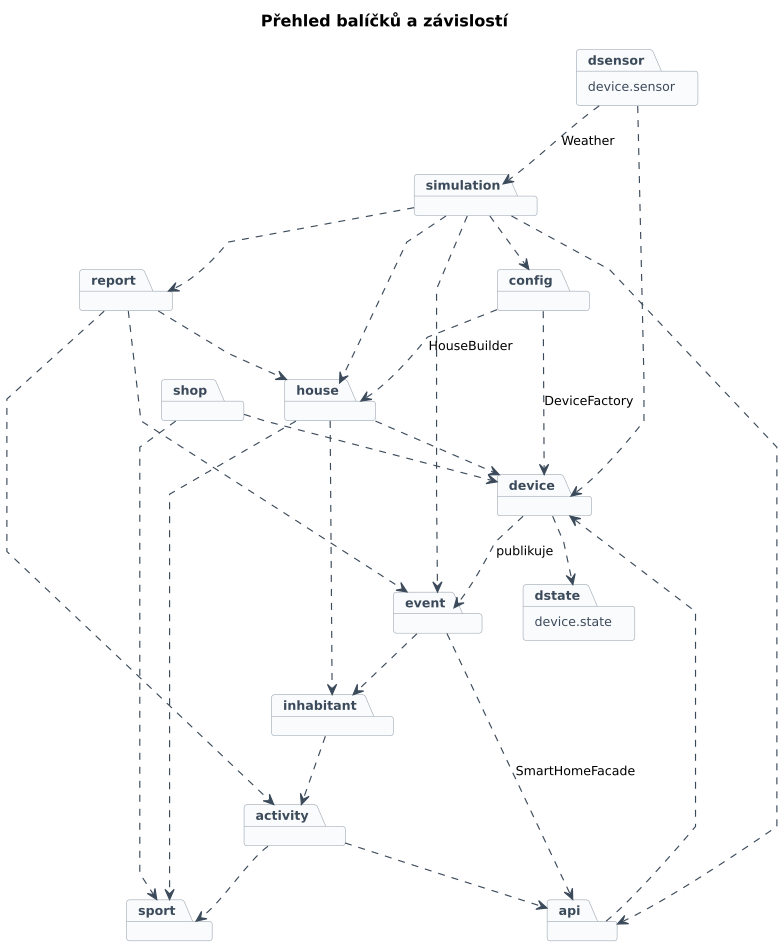{.diagram width=55%}

| Balíček | Odpovědnost |
|---|---|
| `simulation` | Řízení běhu (`Simulation`), simulační čas (`SimulationClock`), počasí (`Weather`). |
| `config` | Načtení konfigurace z JSON nebo z Java třídy, DTO a sestavení domu (`HouseDirector`). |
| `house` | Kompozitní struktura dům → patro → místnost → okno → žaluzie, `HouseBuilder`, `HouseVisitor`. |
| `device`, `device.state`, `device.sensor` | Zařízení, jejich stavy, spotřeba, životnost, obsah, továrna a senzory. |
| `inhabitant` | Členové domácnosti a mazlíčci, oprávnění (`PermissionSet`). |
| `activity` | Aktivity (použití zařízení, sport, úkoly), strategie výběru aktivit, log aktivit. |
| `sport` | Sportovní náčiní a jeho sdílený pool. |
| `event` | Události, sběrnice událostí (Observer) a řetězy jejich obsluhy (Chain of Responsibility). |
| `api` | Veřejné API pro ovládání zařízení: příkazy (Command), ochranná proxy, fasáda pro systém. |
| `report` | Generování a zápis reportů. |
| `shop` | (bonus) Sledování nedostatku zařízení a jejich dokupování. |

# Datový model (class diagramy)

Kompletní class diagram je kvůli velikosti rozdělený do tematických částí. Třídy z jiných balíčků jsou
v dílčích diagramech šedé (`«external»`). Celý model najdete v příloze A: datový model bez metod a kompletní
diagram s metodami. Oba jsou v archivu i jako samostatné SVG/PNG soubory.

**Zapouzdření (NFR-3):** všechny atributy jsou `private`, případně `protected` u abstraktních předků.
Metody měnící vnitřní stav, které nemají být součástí veřejného API, jsou *package-private* (`~`).
Příklady: `Device.setState()`, `Device.breakDown()`, `ConsumptionMeter.record()`, `Durability.wear()`,
`Room.enter()/leave()`. Kolekce se navenek vydávají jen jako nemodifikovatelné pohledy
(`List.copyOf`, `Collections.unmodifiableList`).

## Dům a jeho struktura

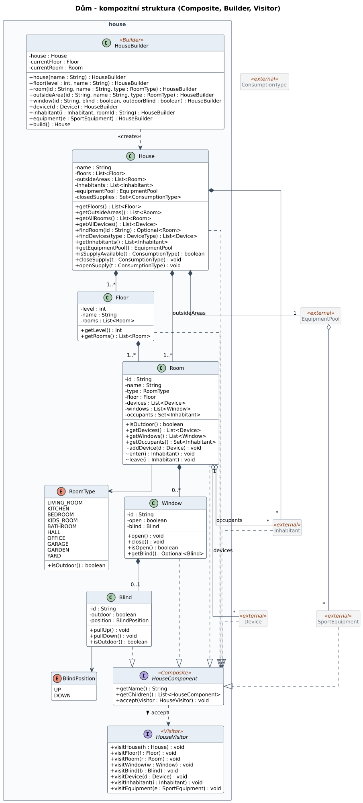{.diagram width=72%}

* `House` obsahuje patra (`Floor`) a venkovní prostory (garáž, zahrada). Venkovní prostory se modelují jako
  `Room` s venkovním `RoomType`.
* Každá `Room` obsahuje okna (`Window`) s volitelnou žaluzií (`Blind`), zařízení (`Device`) a aktuálně přítomné
  obyvatele (`occupants`). Obyvatel je v každém okamžiku **právě v jedné místnosti**. Přesun řeší
  `Inhabitant.moveTo()`, které volá package-private `Room.leave()/enter()`.
* `House.closedSupplies` eviduje uzavřená média (např. uzavřená voda po prasklé trubce). Zařízení, které
  potřebuje uzavřené médium, není dostupné.
* Všechny prvky hierarchie implementují `HouseComponent`, takže je lze jednotně procházet a navštěvovat
  visitorem (report konfigurace, report spotřeby).

::: {.wide-page}

## Zařízení

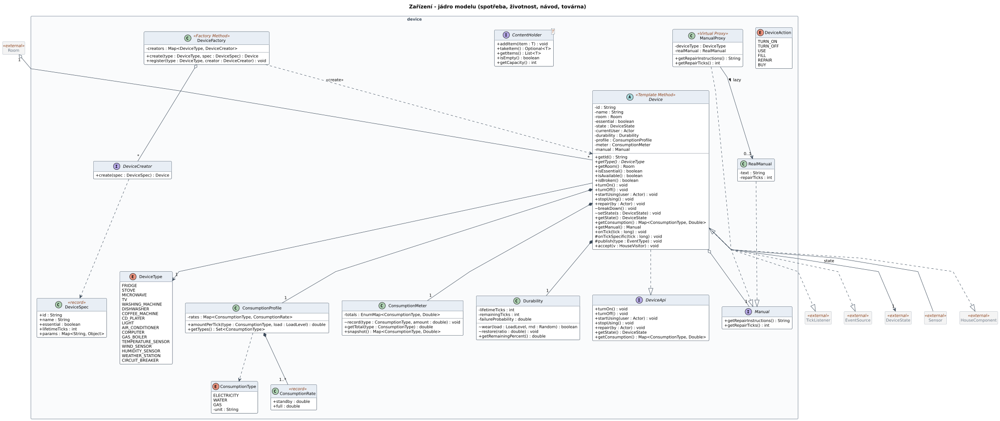{.landscape-img}

:::

* `Device` je abstraktní předek všech zařízení. Drží identitu, umístění, stav (`DeviceState`), životnost
  (`Durability`), profil spotřeby (`ConsumptionProfile`), měřič spotřeby (`ConsumptionMeter`) a návod (`Manual`).
* `ConsumptionProfile` určuje pro každé médium (`ELECTRICITY` v kWh, `WATER` v litrech, `GAS` v m³) spotřebu
  za jeden tick v pohotovostním režimu (`standby`) a při plném provozu (`full`). Kolik se v daném ticku
  skutečně spotřebuje, závisí na `LoadLevel` aktuálního stavu.
* `essential` označuje nutná zařízení (lednice, kotel, senzory, jistič), která zůstávají v provozu při
  výpadku proudu nebo hrozící bouřce.
* `DeviceFactory` vytváří instance podle `DeviceType` a `DeviceSpec` z konfigurace.

::: {.wide-page}

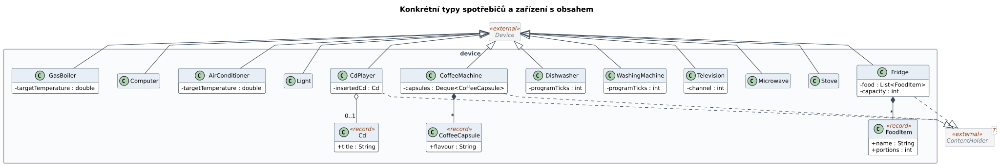{.landscape-img}

:::

Aplikace obsahuje **12 typů spotřebičů** a **5 typů senzorů** (zadání vyžaduje alespoň 8 typů). Zařízení
s obsahem implementují `ContentHolder<T>`: lednice (`FoodItem`), kávovar (`CoffeeCapsule`) a CD přehrávač
(`Cd`).

| Typ | Média | Specifika |
|---|---|---|
| `Fridge` – lednice | elektřina | obsah jídla; prázdná lednice → `FRIDGE_EMPTY` |
| `Stove` – sporák | plyn | vaření jen v zapnutém stavu |
| `Microwave` – mikrovlnka | elektřina | |
| `Television` – televize | elektřina | kanál |
| `WashingMachine` – pračka | elektřina, voda | program trvá N ticků → `PROGRAM_FINISHED` |
| `Dishwasher` – myčka | elektřina, voda | program trvá N ticků → `PROGRAM_FINISHED` |
| `CoffeeMachine` – kávovar | elektřina, voda | spotřebovává kapsle (obsah) |
| `CdPlayer` – CD přehrávač | elektřina | obsah = vložené CD; bez CD nelze přehrávat |
| `Light` – světlo | elektřina | |
| `AirConditioner` – klimatizace | elektřina | reaguje na `HIGH_TEMPERATURE` |
| `Computer` – počítač | elektřina | |
| `GasBoiler` – kotel | plyn, voda | nutné zařízení; reaguje na `LOW_TEMPERATURE` |

::: {.wide-page}

## Stavy zařízení a senzory

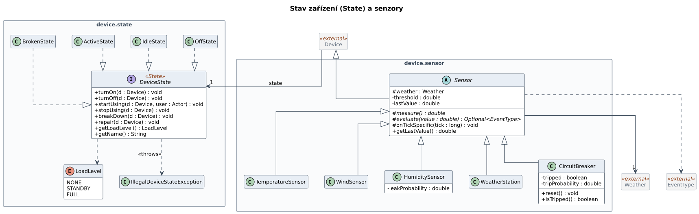{.landscape-img}

:::

Zařízení deleguje všechny operace na aktuální stav, viz problém P5 a stavový diagram v kap. 8.
`Sensor` je abstraktní zařízení. V každém ticku změří veličinu (`measure()`), vyhodnotí ji
(`evaluate()`) a případně publikuje událost.

| Senzor | Měří | Událost |
|---|---|---|
| `TemperatureSensor` | vnitřní teplotu (odvozenou z počasí a stavu klimatizace/kotle) | `HIGH_TEMPERATURE`, `LOW_TEMPERATURE` |
| `WindSensor` | rychlost větru | `STRONG_WIND` |
| `WeatherStation` | blížící se bouřku | `STORM_WARNING` |
| `HumiditySensor` | vlhkost (náhodná porucha potrubí) | `WATER_LEAK` |
| `CircuitBreaker` | stav elektrické sítě (náhodný výpadek) | `POWER_OUTAGE`, `POWER_RESTORED` |

::: {.wide-page}

## Obyvatelé, oprávnění, aktivity a sport

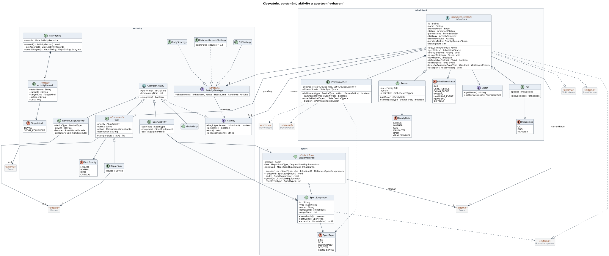{.landscape-img}

:::

* `Inhabitant` je společný předek pro `Person` (role `FamilyRole`) a `Pet` (`PetSpecies`). Implementuje
  `Actor`, tedy entitu, která může volat API zařízení. Druhým aktérem je `SystemActor`.
* `PermissionSet` definuje pro každý `DeviceType` povolené akce (`TURN_ON`, `TURN_OFF`, `USE`, `FILL`,
  `REPAIR`, `BUY`) a povolené druhy sportu. Oprávnění se načítají z konfigurace.
* Obyvatel má frontu úkolů (`PriorityQueue<Task>`). Úkoly (odbavení události, oprava) mají vždy přednost
  před volnočasovou aktivitou, kterou vybírá `ActivityStrategy`.
* `EquipmentPool` spravuje sdílené sportovní náčiní uložené v garáži. Když není volné, obyvatel čeká.
* `ActivityLog` zaznamenává každé použití zařízení i náčiní. Slouží jako zdroj pro `ActivityAndUsageReport`.

::: {.wide-page}

## Události

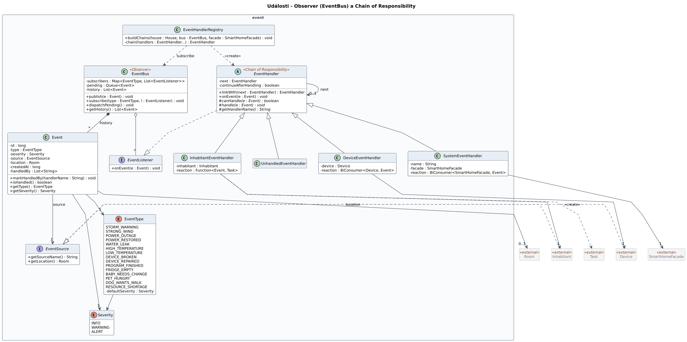{.landscape-img}

:::

* `Event` nese typ, závažnost (`INFO`, `WARNING`, `ALERT`), zdroj (`EventSource` – zařízení nebo obyvatel),
  místo vzniku, čas a seznam entit, které ji odbavily (`handledBy`).
* `EventBus` přijímá publikované události do fronty a v závěru ticku je rozešle přihlášeným posluchačům.
  Zároveň uchovává historii pro `EventReport`.
* Pro každý `EventType` existuje řetěz handlerů (`EventHandler`), který sestaví `EventHandlerRegistry`.
  Handler může událost obsloužit osobou (`InhabitantEventHandler` přidělí úkol), zařízením
  (`DeviceEventHandler`) nebo systémem (`SystemEventHandler` přes fasádu).

::: {.wide-page}

## API pro ovládání zařízení

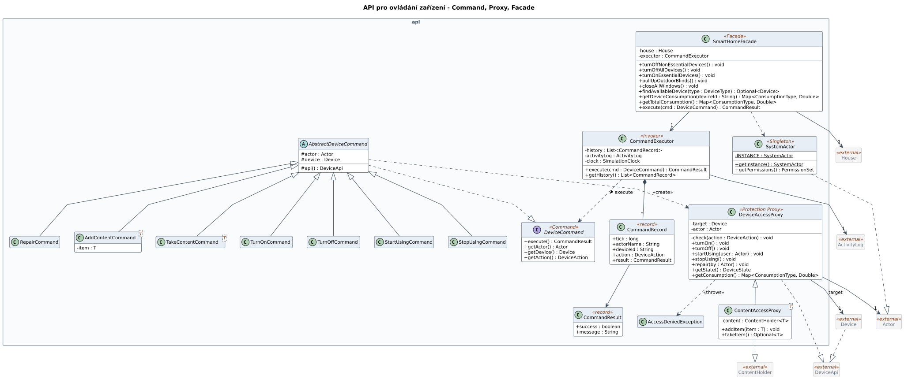{.landscape-img}

:::

* Každá interakce se zařízením je příkaz (`DeviceCommand`), který provede `CommandExecutor`. Ten vede historii
  příkazů a zapisuje do `ActivityLog`.
* Příkaz nepracuje se zařízením přímo, ale přes `DeviceAccessProxy`. Proxy před delegací ověří oprávnění
  aktéra. Pro zařízení s obsahem se použije `ContentAccessProxy<T>`.
* `SmartHomeFacade` nabízí jednoduché systémové operace nad celým domem (vypni vše nedůležité, vytáhni
  venkovní žaluzie, zjisti spotřebu…). Příkazy přitom vykonává jménem `SystemActor`.

::: {.wide-page}

## Reporty

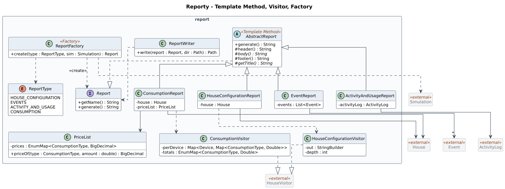{.landscape-img}

:::

* Každý report dědí z `AbstractReport`, který určuje společnou kostru: hlavička s názvem domu a délkou simulace,
  tělo a souhrnná patička. Podtřídy implementují jen `body()`.
* `ReportFactory` vytvoří report podle `ReportType` a předá mu potřebná data ze simulace (dům, historii událostí,
  log aktivit). `ReportWriter` ho zapíše do textového souboru.
* Reporty nad strukturou domu (konfigurace a spotřeba) procházejí dům visitorem. Reporty událostí a aktivit
  čtou z `EventBus.getHistory()` a `ActivityLog`.

::: {.wide-page}

## Konfigurace, simulace a nákupy

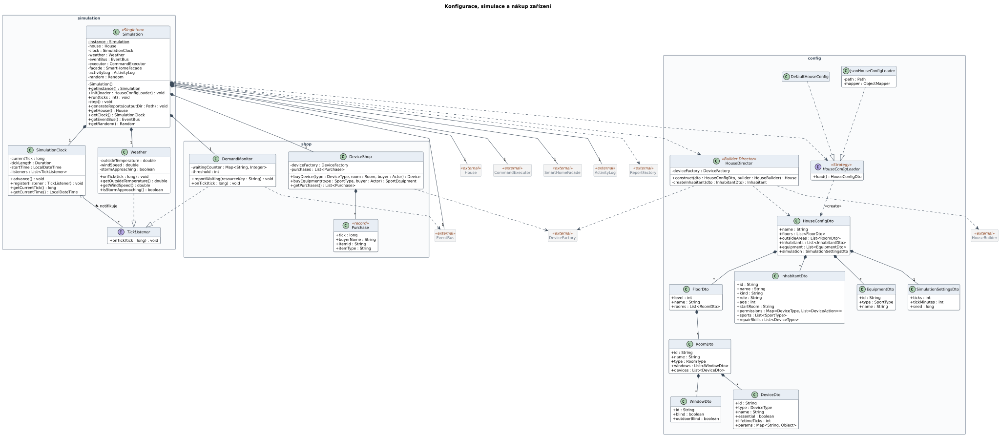{.landscape-img}

:::

* `Simulation.init(loader)` načte konfiguraci zvolenou strategií (`JsonHouseConfigLoader` nebo
  `DefaultHouseConfig`). `HouseDirector` z `HouseConfigDto` sestaví dům pomocí `HouseBuilder` a `DeviceFactory`.
  Pak se zaregistrují posluchači hodin a sestaví se řetězy handlerů událostí.
* `Simulation.run(ticks)` opakovaně volá `step()` (fáze ticku v kap. 8, P18). Nakonec `generateReports()`
  vytvoří reporty.
* `DemandMonitor` a `DeviceShop` realizují bonusový požadavek B2 (dokoupení zařízení a náčiní).

# Funkční požadavky

Každý požadavek je rozepsaný jako systémový požadavek (FR) s detailním popisem a odkazem na třídy,
které ho realizují.

## FR-01 Typy zařízení a jejich umístění
Aplikace obsahuje 12 typů spotřebičů a 5 typů senzorů (tabulky v kap. 3.2 a 3.3). Každé zařízení patří
**právě jedné** místnosti (`Device.room`), místnost leží na patře (`Room.floor`), nebo je venkovním prostorem
(garáž, zahrada, dvorek; `RoomType.isOutdoor()`). Zařízení se mezi místnostmi nepřesouvají.
*Třídy:* `Device` a podtřídy, `Room`, `Floor`, `House`, `DeviceFactory`.

## FR-02 Interakce přes API – uživatelská i systémová
* **Uživatelská interakce:** obyvatel vytvoří příkaz (`TurnOnCommand`, `StartUsingCommand`,
  `AddContentCommand`…) a předá ho `CommandExecutor`. Výsledkem je `CommandResult` (úspěch, nebo
  důvod selhání).
* **Systémová interakce:** `SmartHomeFacade` nabízí hromadné operace, které provádí `SystemActor`:
  * `turnOffNonEssentialDevices()` – výpadek proudu, blížící se bouřka,
  * `turnOffAllDevices()` – úplné vypnutí (konec simulace, dovolená),
  * `pullUpOutdoorBlinds()` – silný vítr,
  * `closeAllWindows()` – bouřka,
  * `getDeviceConsumption(id)`, `getTotalConsumption()` – dotazy na spotřebu.
* Systém nesmí zařízení *používat* (`USE`) ani opravovat (`REPAIR`). Smí je zapínat a vypínat.

## FR-03 Stav zařízení určuje možné interakce; obsah zařízení
* Zařízení má stavy **Off → Idle → Active** a **Broken** (stavový diagram v kap. 8). Použít lze jen zapnuté
  zařízení (Idle). Na vypnutém sporáku nelze uvařit oběd: `startUsing()` ve stavu `OffState` vyhodí
  `IllegalDeviceStateException` a příkaz vrátí neúspěch.
* Spotřeba v ticku se řídí stavem: Off = 0, Idle = standby, Active = full, Broken = 0.
* Zařízení s obsahem (`ContentHolder<T>`):
  * lednice – jídlo (`FoodItem` s počtem porcí). Jídlo se odebírá při použití, při nule porcí se publikuje
    `FRIDGE_EMPTY`.
  * CD přehrávač – vložené CD (kapacita 1). Bez CD nelze přehrávat.
  * kávovar – kapsle. Bez kapsle nelze uvařit kávu.
* Další omezení: zařízení na vodu nelze použít při uzavřeném přívodu vody (`House.isSupplyAvailable`).

## FR-04 Oprávnění členů domácnosti
* Každý obyvatel má `PermissionSet`: mapu `DeviceType → {DeviceAction}` a množinu povolených sportů.
* Kontrolu provádí `DeviceAccessProxy.check(action)` při **každém** volání API. Nepovolená akce vyhodí
  `AccessDeniedException`, příkaz vrátí neúspěch a pokus se zaznamená.
* Oprava navíc vyžaduje dovednost (`Person.repairSkills`). Například televizi opraví jen táta.
* Příklady z připravené konfigurace: kočka smí jen zapnout televizi (sedne na ovladač), myčku zapnout nemůže.
  Miminko nemá žádná oprávnění. Dcera nesmí ke sporáku ani k pračce.

## FR-05 Volný čas: 50 % zařízení / 50 % sport, čekání na zdroje
* Volnočasovou aktivitu volí `BalancedLeisureStrategy`. S pravděpodobností 0,5 zvolí použití zařízení
  (náhodný typ z typů, které smí obyvatel používat), jinak sport (náhodný povolený druh).
* Pokud není volné žádné zařízení daného typu nebo žádné náčiní (`EquipmentPool.acquire()` vrátí prázdný
  `Optional`), obyvatel přejde do stavu `WAITING`. Aktivitu si ponechá a v dalším ticku to zkusí znovu.
  Čekání se hlásí do `DemandMonitor` (bonus B2).
* Miminko (`BabyStrategy`) spí a pláče. Mazlíčci (`PetStrategy`) se toulají po místnostech a generují
  události. Ani jedni nesportují.
* Během sportu je osoba ve venkovním prostoru (zahrada) a náčiní je vypůjčené z poolu v garáži.

## FR-06 Spotřeba zařízení přes API
* Každé zařízení má `ConsumptionMeter`, který v každém ticku přičte spotřebu podle profilu a stavu.
* Spotřebu vrací `DeviceApi.getConsumption()` (mapa médium → množství) a souhrnně
  `SmartHomeFacade.getTotalConsumption()`.

## FR-07 Poloha entit, pohyb osob a náhodné události
* Každé zařízení i obyvatel je v každém okamžiku v právě jedné místnosti. Osoby se přesouvají metodou
  `moveTo(room)`, například k použitému zařízení, do garáže pro náčiní nebo na místo události.
* Události generují zařízení (porucha, konec programu, prázdná lednice), senzory (vítr, bouřka, únik vody,
  výpadek proudu, teplota) i obyvatelé (miminko potřebuje přebalit, pes chce na procházku, hladový mazlíček).
* Událost má závažnost: `INFO` (informace), `WARNING`, nebo `ALERT` (upozornění vyžadující zásah).

## FR-08 Odbavení událostí vhodnou osobou nebo zařízením
Pro každý typ události existuje řetěz handlerů. Handler, který událost umí obsloužit, ji obslouží a podle
konfigurace ji buď pošle dál (událost vyžaduje víc aktérů), nebo řetěz ukončí.

| Událost | Zdroj | Řetěz obsluhy (v pořadí) |
|---|---|---|
| `STRONG_WIND` | `WindSensor` | systém: vytažení venkovních žaluzií |
| `STORM_WARNING` | `WeatherStation` | systém: zavření oken → systém: vypnutí nedůležitých zařízení |
| `POWER_OUTAGE` | `CircuitBreaker` | systém: vypnutí nedůležitých zařízení (nutná zůstávají) → táta: nahození jističe |
| `POWER_RESTORED` | `CircuitBreaker` | systém: zapnutí nutných zařízení (INFO) |
| `WATER_LEAK` | `HumiditySensor` | máma: zavolá hasiče → táta: uzavře vodu → dcera: vyloví křečka |
| `BABY_NEEDS_CHANGE` | miminko | táta: *skrývá se* (`canHandle = false`) → máma: přebalí |
| `DEVICE_BROKEN` | zařízení | člen s dovedností opravit daný typ → jinak máma: koupí nové (B2) |
| `FRIDGE_EMPTY` | lednice | máma → táta: nákup a doplnění lednice (`AddContentCommand`) |
| `HIGH_TEMPERATURE` | `TemperatureSensor` | zařízení: klimatizace se zapne → systém: stažení žaluzií |
| `LOW_TEMPERATURE` | `TemperatureSensor` | zařízení: kotel zvýší výkon |
| `PROGRAM_FINISHED` | pračka, myčka | kdokoli doma s oprávněním `USE`: vyndá prádlo / nádobí (INFO) |
| `DOG_WANTS_WALK` | pes | syn → táta: procházka (osoba i pes se přesunou na zahradu) |
| `PET_HUNGRY` | mazlíček | dcera → máma: nakrmí |
| `RESOURCE_SHORTAGE` | `DemandMonitor` | táta (oprávnění `BUY`): koupí další zařízení / náčiní (B2) |

Handler osoby obslouží událost jen tehdy, když je osoba doma a není zaneprázdněná úkolem vyšší priority.
Jinak událost pošle dál. Na konci každého řetězu je `UnhandledEventHandler`, který zaznamená neodbavené
události do reportu.

## FR-09 Reporty
Reporty se generují po skončení simulace (`Simulation.generateReports(dir)`) do samostatných textových
souborů. Ukázky formátu jsou v příloze C.

* **HouseConfigurationReport** – stromový výpis celé hierarchie *dům → patro → místnost → okno → žaluzie /
  zařízení*, dále obyvatelé (role, oprávnění) a sportovní náčiní. Generuje ho `HouseConfigurationVisitor`.
* **EventReport** – seznam všech událostí seskupený podle typu, pak podle zdroje a pak podle entity, která
  událost odbavila. Obsahuje i čas a počty.
* **ActivityAndUsageReport** – pro každou osobu počet použití jednotlivých zařízení a sportovního náčiní,
  odmítnuté pokusy (chybějící oprávnění) a celkový čas čekání.
* **ConsumptionReport** – spotřeba elektřiny, vody a plynu po zařízeních, součty po místnostech a za dům
  a orientační cena podle ceníku (`PriceList`). Generuje ho `ConsumptionVisitor`.

## FR-10 Připravená konfigurace domu
Aplikace obsahuje jednu názornou konfiguraci (kap. 7). Je dostupná jako JSON (`config/house-config.json`)
i jako Java třída `DefaultHouseConfig`.

## Bonus B1 – životnost a opravy
* `Durability` v každém ticku ubírá životnost podle zátěže (Active > Idle > Off). Rozbití je náhodné
  s pravděpodobností, která roste s opotřebením. Při vyčerpání životnosti nastane jistě.
* Rozbité zařízení (`BrokenState`) nelze používat a **nereaguje ani na systémové ovládání**. Fasáda ho při
  hromadných operacích přeskočí.
* Opravu provádí člen s dovedností. `RepairTask` má prioritu `HIGH`, takže přeruší volnočasovou aktivitu.
  Délku opravy určuje návod (`Manual`), který se načítá líně až při první opravě (`ManualProxy`).
  Oprava obnoví část životnosti.

## Bonus B2 – dokoupení zařízení
* `DemandMonitor` sčítá, kolikrát obyvatelé čekali na daný typ zařízení nebo náčiní. Při překročení prahu
  za časové okno publikuje `RESOURCE_SHORTAGE`.
* Událost obslouží člen s oprávněním `BUY`. `DeviceShop` vytvoří nové zařízení přes `DeviceFactory` (nebo
  náčiní) a umístí ho do vhodné místnosti nebo poolu. Nákup se zaznamená a objeví se v reportech.
* Stejným mechanismem se řeší i rozbité zařízení, které nikdo neumí opravit.

# Nefunkční požadavky

| ID | Požadavek | Řešení v návrhu |
|---|---|---|
| NFR-1 | Bez autentizace a autorizace uživatelů aplikace | Oprávnění (FR-04) jsou doménová pravidla simulace, nejde o přihlašování. |
| NFR-2 | Běh v jedné JVM | Jednovláknová simulace řízená `SimulationClock`. |
| NFR-3 | Skrytí metod a zapouzdření | Atributy `private`, interní metody package-private, kolekce jen pro čtení, změny stavu jen přes API/příkazy. |
| NFR-4 | Reporty do textového souboru | `ReportWriter` zapisuje každý report do `reports/<Název>.txt`. |
| NFR-5 | Konfigurace z třídy i z JSON | Strategie `HouseConfigLoader`: `DefaultHouseConfig` a `JsonHouseConfigLoader`. |
| NFR-6 | Reprodukovatelnost (vlastní) | Jediný `Random` se seedem z konfigurace, sdílený přes `Simulation`. |
| NFR-7 | Rozšiřitelnost (vlastní) | Nový typ zařízení = nová podtřída + registrace v `DeviceFactory`; nová reakce = nový handler v řetězu. |

# Uživatelské scénáře

Aplikace je simulace, takže „uživateli“ jsou simulovaní členové domácnosti a systém domu. Scénáře popisují
typické interakce a jejich alternativní průběhy.

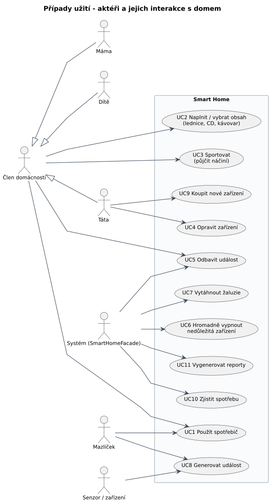{.diagram width=62%}

## UC1 – Člen domácnosti použije spotřebič (syn si pustí televizi)
**Aktér:** Tomáš (syn). **Předpoklad:** Tomáš nemá žádný čekající úkol, strategie zvolila „použít zařízení – TV“.

1. Aktivita vyhledá volnou a nerozbitou televizi (`SmartHomeFacade.findAvailableDevice(TV)`).
2. Tomáš se přesune do místnosti s televizí.
3. Provede se `TurnOnCommand`. Proxy ověří oprávnění `TURN_ON` a televize přejde z Off do Idle.
4. Provede se `StartUsingCommand`. Proxy ověří `USE` a televize přejde do Active.
5. Tomáš se dívá N ticků. Televize spotřebovává elektřinu a opotřebovává se.
6. Po skončení se provede `StopUsingCommand` a `TurnOffCommand`. Použití se zapíše do `ActivityLog`.

**Alternativy:**
3a. Volnou televizi nenašel → Tomáš čeká (`WAITING`) a v dalším ticku to zkusí znovu (FR-05).
4a. Televize se během sledování rozbije → aktivita končí a publikuje se `DEVICE_BROKEN` (UC5).
4b. Aktér nemá oprávnění (např. dcera a sporák) → `AccessDeniedException` a aktivita se zruší.

## UC2 – Vaření oběda (stav podmiňuje interakci)
**Aktér:** Jana (máma).

1. Jana se přesune do kuchyně a vezme z lednice jídlo (`TakeContentCommand`).
2. Pokusí se vařit (`StartUsingCommand` na sporák).
3. Sporák je vypnutý, takže `OffState` odmítne použití.
4. Jana sporák zapne (`TurnOnCommand`) a vaří. Spotřebovává se plyn.

**Alternativy:** 1a. Lednice je prázdná → publikuje se `FRIDGE_EMPTY` a Jana dostane úkol nakoupit (UC6).

## UC3 – Sport a čekání na náčiní
**Aktér:** Eva (dcera).

1. Strategie zvolí sport, náhodně z povolených druhů vybere „kolo“.
2. Eva jde do garáže a požádá `EquipmentPool` o kolo.
3. Kolo je volné → Eva si ho vypůjčí, přesune se na zahradu a jezdí N ticků.
4. Kolo vrátí do poolu. Použití se zapíše do logu.

**Alternativy:** 3a. Obě kola jsou vypůjčená → Eva čeká v garáži, čekání se hlásí `DemandMonitor`.
Po překročení prahu vznikne `RESOURCE_SHORTAGE` a táta koupí další kolo (B2).

## UC4 – Blíží se bouřka (systémová interakce)
**Aktér:** systém (`WeatherStation` + `SmartHomeFacade`).

1. Meteostanice zjistí blížící se bouřku a publikuje `STORM_WARNING` (ALERT).
2. Systémový handler zavře všechna okna.
3. Další handler vypne všechna nedůležitá zařízení. Rozbitá zařízení ignorují i systémový příkaz.
4. Nutná zařízení (lednice, kotel, senzory) zůstávají v provozu.

## UC5 – Porucha zařízení a oprava (B1)
**Aktér:** zařízení (pračka), Petr (táta).

1. Pračce dojde životnost. Přejde do `BrokenState` a publikuje `DEVICE_BROKEN`.
2. Řetěz najde tátu, který umí opravit pračku a je doma. Přidělí mu `RepairTask` s prioritou HIGH.
3. Táta přeruší aktuální volnočasovou aktivitu a jde do koupelny.
4. Načte se návod (lazy), oprava trvá podle návodu několik ticků.
5. Provede se `RepairCommand`. Pračka přejde do Off, životnost se částečně obnoví a publikuje se `DEVICE_REPAIRED`.

**Alternativy:** 2a. Táta sportuje mimo dům → úkol dostane, až se vrátí, nebo ho převezme jiný člen
s dovedností. 2b. Nikdo zařízení opravit neumí → máma koupí nové (B2).

## UC6 – Došlo jídlo v lednici
1. Při odebrání poslední porce lednice publikuje `FRIDGE_EMPTY` (WARNING).
2. Máma dostane úkol „nákup“: opustí dům na několik ticků.
3. Po návratu doplní lednici (`AddContentCommand`, vyžaduje `FILL`).

## UC7 – Prasklá trubka
1. Čidlo vlhkosti v koupelně detekuje únik vody a publikuje `WATER_LEAK` (ALERT).
2. Máma zavolá hasiče, táta uzavře hlavní přívod vody (`House.closeSupply(WATER)`) a dcera vyloví křečka.
   Událost má v `handledBy` všechny tři osoby.
3. Zařízení spotřebovávající vodu (pračka, myčka, kávovar) jsou nedostupná, dokud táta po opravě vodu znovu
   neotevře.

## UC8 – Miminko potřebuje přebalit
1. Miminko náhodně publikuje `BABY_NEEDS_CHANGE`.
2. První v řetězu je táta. Jeho handler vrátí `canHandle = false` (táta se skrývá) a událost jde dál.
3. Máma dostane úkol přebalit (priorita HIGH).

## UC9 – Výpadek elektřiny
1. Jistič náhodně vypadne a publikuje `POWER_OUTAGE` (ALERT).
2. Systém vypne všechna nedůležitá zařízení. Nutná zařízení běží dál (záložní zdroj).
3. Táta dostane úkol nahodit jistič. Po jeho splnění se publikuje `POWER_RESTORED`.

## UC10 – Konec simulace a reporty
1. Po posledním ticku `Simulation` vytvoří přes `ReportFactory` všechny čtyři reporty.
2. `ReportWriter` je zapíše do adresáře `reports/` jako textové soubory.

# Připravená konfigurace domu

Konfigurace je v souboru `config/house-config.json` (příloha B) a stejná data obsahuje i `DefaultHouseConfig`.

| Požadavek zadání | Minimum | Konfigurace |
|---|---|---|
| Členové domácnosti | 5 | 5 osob (táta, máma, syn, dcera, miminko) + 3 mazlíčci (kočka, pes, křeček) |
| Spotřebiče / zařízení | 20 ks, 8 druhů | 29 ks, 17 druhů (12 spotřebičů + 5 senzorů) |
| Sportovní náčiní | 5 ks | 7 ks (2× kolo, 2× lyže, snowboard, koloběžka, brusle) |
| Místnosti | 6 + venku | 7 místností ve 2 patrech + garáž a zahrada |

**Rozmístění zařízení**

| Patro / prostor | Místnost | Zařízení |
|---|---|---|
| Přízemí | Předsíň | světlo, jistič |
| | Obývací pokoj (2 okna, venkovní žaluzie) | televize, CD přehrávač, světlo, klimatizace, teploměr |
| | Kuchyně (okno, vnitřní žaluzie) | lednice, sporák, mikrovlnka, myčka, kávovar, světlo, čidlo vlhkosti |
| Patro | Ložnice rodičů (okno, venkovní žaluzie) | lampička, televize |
| | Pokoj Tomáše a Adama | počítač, světlo |
| | Pokoj Evy | notebook, lampa |
| | Koupelna | pračka, plynový kotel, světlo, čidlo vlhkosti |
| Venku | Garáž | světlo, lednice na nápoje, *sklad sportovního náčiní* |
| | Zahrada | anemometr, meteostanice, zahradní lampa |

**Obyvatelé a oprávnění**

| Obyvatel | Oprávnění k zařízením | Opravuje | Sporty |
|---|---|---|---|
| Petr (táta, 42) | vše včetně `REPAIR`, `BUY` | TV, pračka, myčka, PC, světla, CD, mikrovlnka, klimatizace, kotel, jistič | kolo, lyže, snowboard |
| Jana (máma, 39) | vše kromě oprav, `BUY` | kávovar | kolo, lyže, brusle |
| Tomáš (syn, 14) | TV, PC, CD, mikrovlnka, myčka, světla; lednice (`USE`, `FILL`) | PC | kolo, lyže, snowboard, koloběžka |
| Eva (dcera, 10) | TV, PC, CD, světla; lednice (`USE`) | – | kolo, koloběžka, brusle, lyže |
| Adam (miminko, 1) | žádná | – | – |
| Micka (kočka) | TV: jen `TURN_ON` | – | – |
| Rex (pes), Pepík (křeček) | žádná | – | – |

# Problémy při sestavování návrhu a vytipované návrhové vzory

Každý problém má popis, zvolené řešení, zvažované alternativy a důsledky.

## P1 – Hierarchická struktura domu a její jednotné procházení
**Problém:** Dům tvoří stromová hierarchie (dům → patro → místnost → okno → žaluzie, místnost → zařízení).
Reporty a hromadné operace ji potřebují procházet jednotně, bez větvení podle typu prvku.
**Řešení:** **Composite**. Všechny prvky implementují `HouseComponent` s `getChildren()` a `accept()`.
Rekurzivní průchod je společný pro všechny uzly.
**Důsledky:** Přidání nové úrovně (např. „křídlo domu“) nevyžaduje změnu klientů. Nevýhodou je obecné
rozhraní, kde listy vracejí prázdné potomky.

## P2 – Různé výstupy nad stejnou strukturou (reporty)
**Problém:** Nad stejnou hierarchií potřebujeme víc nesouvisejících operací: výpis konfigurace, součty
spotřeby, případně další statistiky. Kdyby každá operace byla metodou doménových tříd, třídy by nabobtnaly.
**Řešení:** **Visitor** (`HouseVisitor`, `HouseConfigurationVisitor`, `ConsumptionVisitor`).
Nová operace = nový visitor, doménové třídy zůstávají beze změny.
**Alternativa:** iterace přes `getAllDevices()` a `instanceof`. Byla zamítnuta jako křehká.
**Důsledky:** Přidání nového typu uzlu vyžaduje změnu rozhraní visitoru. Hierarchie je ale stabilní,
takže to je přijatelné.

## P3 – Sestavení složitého domu z konfigurace
**Problém:** Dům se skládá z mnoha vzájemně provázaných objektů (obousměrné vazby místnost ↔ zařízení,
místnost ↔ obyvatel). Konstrukce musí zajistit konzistenci a skrýt package-private settery.
**Řešení:** **Builder** (`HouseBuilder`, fluent API) + **Director** (`HouseDirector`), který podle DTO
volá kroky builderu. `build()` validuje invarianty: každá entita je v právě jedné místnosti a ID jsou
unikátní.
**Důsledky:** Stejný builder slouží pro JSON i pro konfiguraci v kódu. Testy si mohou snadno postavit malý dům.

## P4 – Načítání konfigurace z různých zdrojů
**Problém:** Konfigurace se má načítat z Java třídy i z externího JSON. Do budoucna může přibýt další formát.
**Řešení:** **Strategy** – `HouseConfigLoader` s implementacemi `JsonHouseConfigLoader` a `DefaultHouseConfig`.
Obě vrací stejné `HouseConfigDto`, takže zbytek aplikace zdroj nezná.

## P5 – Chování zařízení závislé na stavu
**Problém:** Stejná operace (`turnOn`, `startUsing`, `repair`) se chová různě podle stavu zařízení. Rozbité
zařízení nereaguje vůbec a vypnuté nelze použít. Implementace přes `switch`/`if` ve všech zařízeních by
duplikovala logiku a byla náchylná k chybám.
**Řešení:** **State** – `DeviceState` s implementacemi `OffState`, `IdleState`, `ActiveState`, `BrokenState`.
Zařízení deleguje operace na stav a stav určuje přechody i zátěž (`LoadLevel`) pro výpočet spotřeby
a opotřebení. Stavy jsou bezstavové singletony a sdílí se mezi zařízeními.

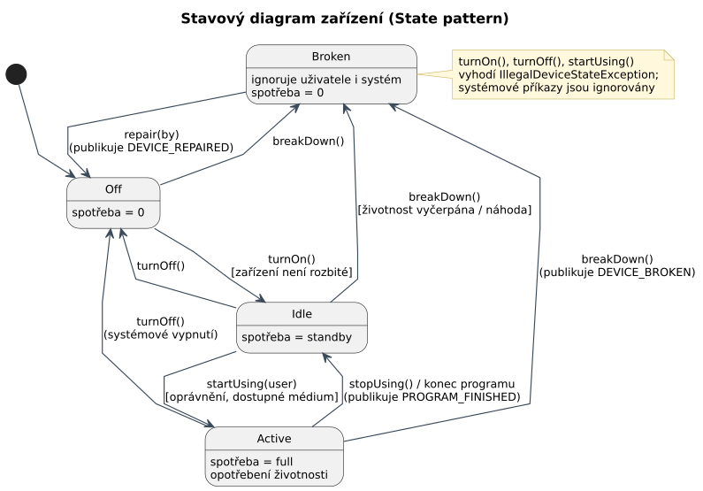{.diagram width=75%}

## P6 – Společný průběh ticku, specifické chování zařízení a obyvatel
**Problém:** Každé zařízení v ticku musí změřit spotřebu, opotřebovat se a ohlásit poruchu. Navíc má vlastní
logiku: pračka odpočítává program, senzor měří. Každý obyvatel má stejnou rozhodovací kostru (úkol >
pokračování aktivity > nová aktivita), ale liší se generováním událostí.
**Řešení:** **Template Method** – `Device.onTick()` je finální kostra, která volá hook `onTickSpecific()`.
`Inhabitant.onTick()` volá abstraktní `maybeGenerateEvent()`. Template Method používají také reporty:
`AbstractReport.generate()` = `header()` + `body()` + `footer()`.

## P7 – Vytváření mnoha typů zařízení podle konfigurace
**Problém:** Konfigurace obsahuje typ zařízení jako text nebo enum. Klient nemá znát konkrétní konstruktory
17 tříd.
**Řešení:** **Factory Method** (registr tvůrců) – `DeviceFactory.create(type, spec)` podle `DeviceType`
vybere zaregistrovaný `DeviceCreator`. Továrnu používá `HouseDirector` i `DeviceShop` (B2). Nový typ
se jen zaregistruje.

## P8 – Kontrola oprávnění při každé interakci
**Problém:** Každý člen domácnosti smí se zařízeními dělat jen některé akce. Kontrola nemá být rozesetá
v 17 třídách zařízení a nesmí jít obejít.
**Řešení:** **Protection Proxy** – `DeviceAccessProxy` (a `ContentAccessProxy<T>`) implementuje stejné
rozhraní `DeviceApi` jako zařízení. Před delegací ověří `actor.getPermissions().isAllowed(type, action)`.
Mutující metody zařízení jsou mimo balíček dostupné jen přes API, které klient dostane zabalené v proxy.
**Důsledky:** Oprávnění se kontrolují na jednom místě a zařízení o nich neví (Single Responsibility).

## P9 – Interakce jako objekty: logování, statistiky, jednotné provádění
**Problém:** Report `ActivityAndUsageReport` potřebuje vědět, kdo kdy co se kterým zařízením udělal. Navíc
chceme jednotně zachytávat chyby (stav, oprávnění) a interakce plánovat (úkol = posloupnost akcí).
**Řešení:** **Command** – `DeviceCommand` a jeho implementace (`TurnOnCommand`, `StartUsingCommand`,
`RepairCommand`, `AddContentCommand`…). Provádí je **invoker** `CommandExecutor`, který vede historii
(`CommandRecord`) a zapisuje do `ActivityLog`. Úkol `Task` je také příkaz: zapouzdřená akce s prioritou,
kterou provede přidělená osoba.

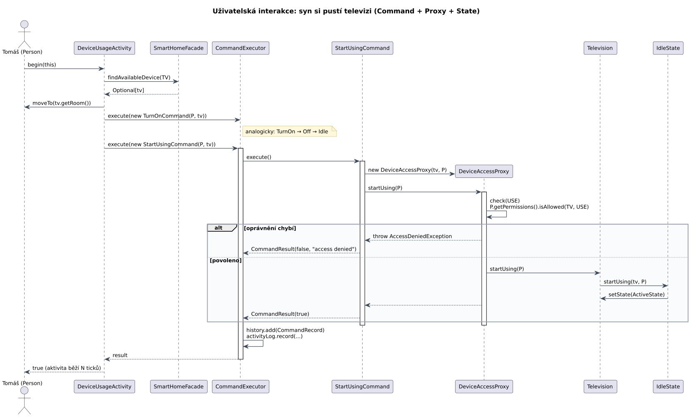{.diagram width=95%}

## P10 – Jednoduché systémové ovládání celého domu
**Problém:** Systémové reakce (bouřka, výpadek, vítr) pracují s desítkami zařízení, oken a žaluzií. Klient
(handler události) nemá znát strukturu domu, příkazy ani proxy.
**Řešení:** **Facade** – `SmartHomeFacade` poskytuje operace na vysoké úrovni (`turnOffNonEssentialDevices()`,
`pullUpOutdoorBlinds()`, `getTotalConsumption()`…). Uvnitř prochází dům a vytváří příkazy za `SystemActor`.

## P11 – Volné propojení zdrojů a příjemců událostí
**Problém:** Události vznikají v zařízeních, senzorech i osobách a obsluhují je jiné osoby, zařízení
nebo systém. Zdroj nemá znát příjemce a při odbavení události by vznikaly cyklické závislosti (osoba
reaguje → zařízení publikuje další událost…).
**Řešení:** **Observer / Publish–Subscribe** – `EventBus` s registrací posluchačů podle `EventType`.
Události se během ticku jen řadí do fronty a rozesílají se až na konci ticku (`dispatchPending()`).
Tím se zabrání rekurzi a pořadí zpracování je deterministické. Observer používá i `SimulationClock`
s `TickListener`.

## P12 – Výběr vhodného obsluhovatele a obsluha více aktéry
**Problém:** Událost má obsloužit „vhodná“ osoba nebo zařízení. Vhodnost závisí na roli, dovednosti
a dostupnosti (je doma, není zaneprázdněná). Některé události vyžadují víc aktérů (prasklá trubka),
jiné jen prvního dostupného (oprava). Některý aktér obsluhu odmítne (táta se skrývá před přebalováním).
**Řešení:** **Chain of Responsibility** – pro každý `EventType` řetěz `EventHandler`ů. Každý článek
rozhodne `canHandle()`, případně `handle()`. Podle příznaku `continueAfterHandling` událost pošle dál.
Řetězy staví `EventHandlerRegistry` a poslední článek `UnhandledEventHandler` zachytí neodbavené události.
**Důsledky:** Pořadí i složení reakcí jde měnit bez zásahu do osob a zařízení.

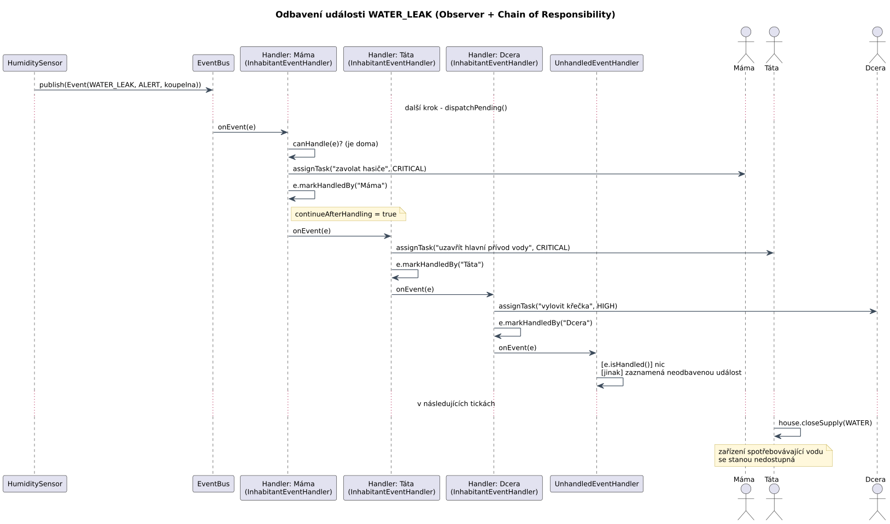{.diagram width=95%}

## P13 – Rozhodování obyvatel o aktivitách (50 % / 50 %)
**Problém:** Dospělí a děti volí mezi zařízením a sportem v poměru 50:50, miminko a mazlíčci se chovají
úplně jinak. Rozhodovací logika se může ladit nezávisle na třídě osoby.
**Řešení:** **Strategy** – `ActivityStrategy` (`BalancedLeisureStrategy` s parametrem `sportRatio`,
`BabyStrategy`, `PetStrategy`). Strategie se přiřazuje podle role při sestavení domu.

## P14 – Sdílené omezené sportovní náčiní a čekání
**Problém:** Náčiní je omezené a sdílené. Vypůjčit si ho může vždy jen jedna osoba, ostatní čekají.
Potřebujeme evidovat vypůjčení, vrácení a nedostatek.
**Řešení:** **Object Pool** – `EquipmentPool.acquire()/release()` hlídá volné a vypůjčené kusy.
Prázdný `Optional` značí, že osoba čeká. Stejný princip (vyhledání volného zařízení) používá
`SmartHomeFacade.findAvailableDevice()`.

## P15 – Jediný kontext simulace a sdílený čas / náhoda
**Problém:** Hodiny, generátor náhodných čísel a sběrnice událostí musí být v simulaci právě jednou
a musí být dostupné z mnoha míst.
**Řešení:** **Singleton** pro `Simulation` (a `SystemActor`). Abychom omezili skryté závislosti,
předávají se klíčové služby (`EventBus`, `CommandExecutor`, `Random`) přednostně konstruktorem.
Singleton slouží jen jako kořen kontextu. V testech se instance resetuje metodou s package-private
viditelností.

## P16 – Drahé načítání návodu k zařízení (bonus B1)
**Problém:** Návod k opravě je potřeba jen u rozbitých zařízení a jeho načtení je „drahé“.
**Řešení:** **Virtual Proxy / Lazy Loading** – `ManualProxy` vytvoří `RealManual` až při prvním volání.

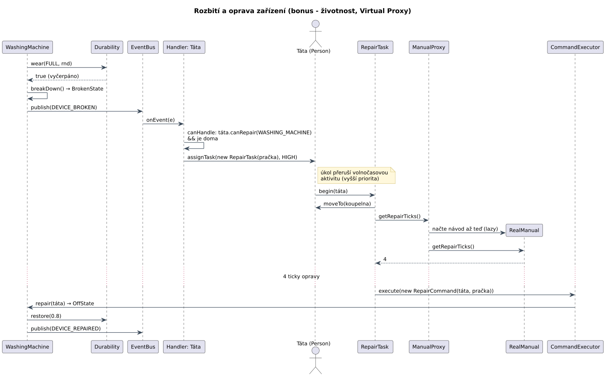{.diagram width=95%}

## P17 – Tvorba reportů a jejich rozšiřitelnost
**Problém:** Čtyři reporty sdílí strukturu (hlavička s časem simulace, tělo, patička se souhrnem) a mají
vznikat jednotně podle typu.
**Řešení:** **Template Method** (`AbstractReport`) + **Simple Factory** (`ReportFactory.create(ReportType)`).
`ReportWriter` odděluje tvorbu obsahu od zápisu do souboru (Single Responsibility).

## P18 – Pořadí operací v rámci kroku simulace
**Problém:** Nejednoznačné pořadí (osoba použije zařízení dřív, než se v témže ticku rozbije) by vedlo
k nedeterministickým výsledkům.
**Řešení:** Pevně definované fáze ticku v `Simulation.step()` a odložené rozesílání událostí (P11).

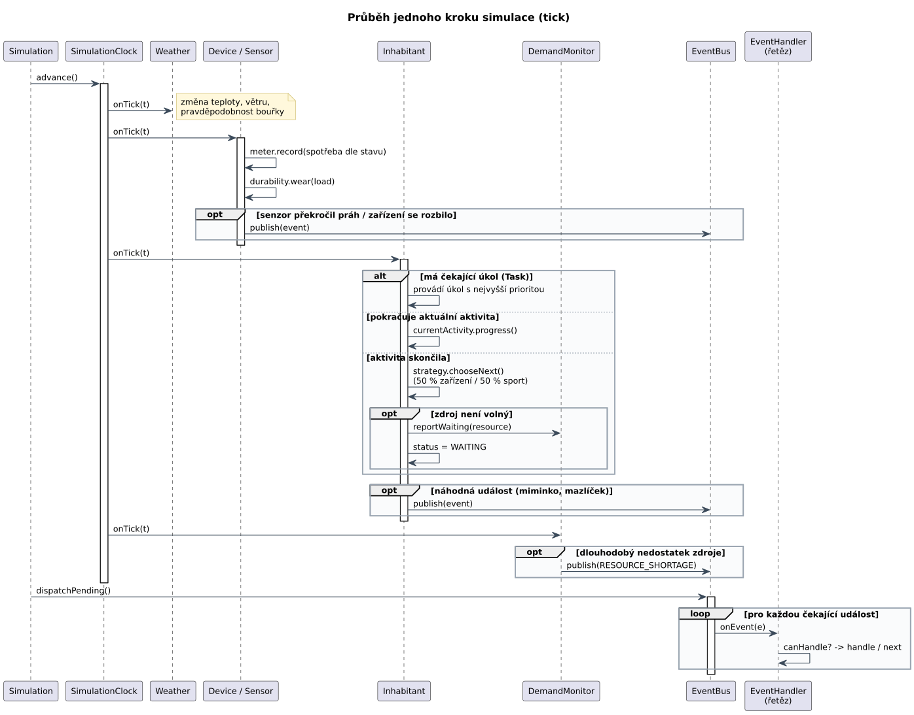{.diagram width=95%}

## Souhrn použitých návrhových vzorů

| Vzor | Kde | Problém |
|---|---|---|
| Composite | `HouseComponent`, `House`, `Floor`, `Room`, `Window`, `Blind`, `Device` | P1 |
| Visitor | `HouseVisitor`, `HouseConfigurationVisitor`, `ConsumptionVisitor` | P2 |
| Builder (+ Director) | `HouseBuilder`, `HouseDirector` | P3 |
| Strategy | `HouseConfigLoader`; `ActivityStrategy` | P4, P13 |
| State | `DeviceState` a stavy | P5 |
| Template Method | `Device.onTick`, `Inhabitant.onTick`, `AbstractReport` | P6, P17 |
| Factory Method | `DeviceFactory` + `DeviceCreator`, `ReportFactory` | P7, P17 |
| Proxy (Protection) | `DeviceAccessProxy`, `ContentAccessProxy` | P8 |
| Proxy (Virtual) | `ManualProxy` | P16 |
| Command | `DeviceCommand`, `CommandExecutor`, `Task` | P9 |
| Facade | `SmartHomeFacade` | P10 |
| Observer | `EventBus`, `SimulationClock` / `TickListener` | P11 |
| Chain of Responsibility | `EventHandler` a potomci | P12 |
| Object Pool | `EquipmentPool` | P14 |
| Singleton | `Simulation`, `SystemActor`, stavy zařízení | P15 |

::: {.landscape}

# Příloha A – kompletní class diagram {-}

## A.1 Datový model (atributy a vazby) {-}

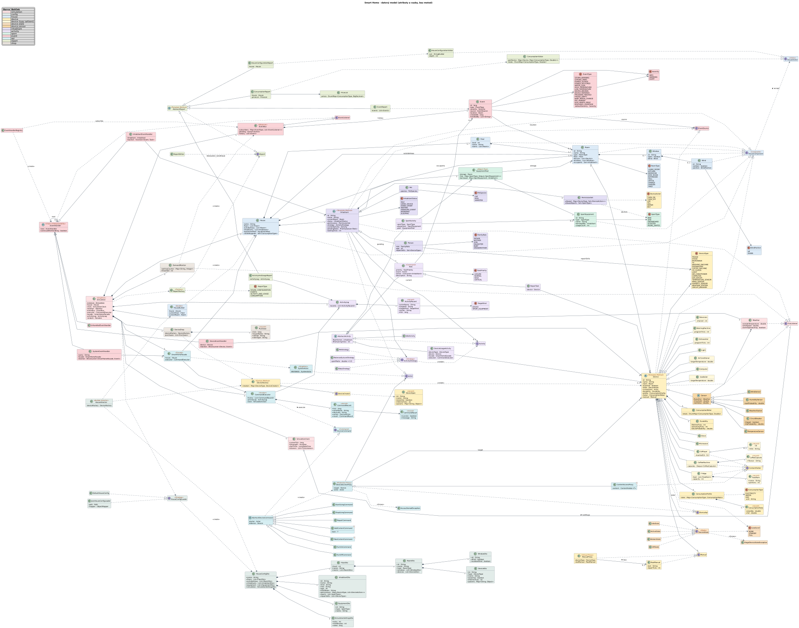{.full}

## A.2 Kompletní diagram včetně metod {-}

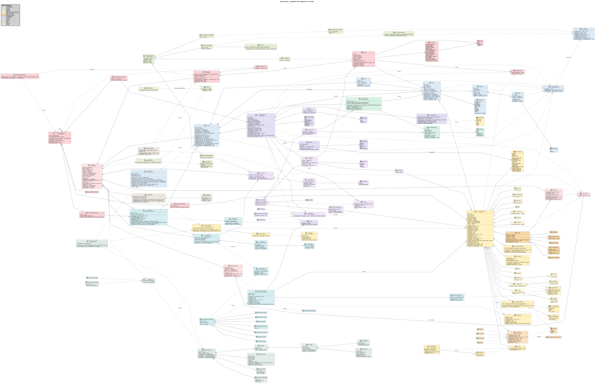{.full}

:::

# Příloha B – konfigurace domu v JSON (výňatek) {-}

Celý soubor je v archivu jako `config/house-config.json`. Klíč `"*"` v oprávněních znamená „všechny typy
spotřebičů“.

```json
{
  "name": "Rodinný dům Novákových",
  "simulation": { "ticks": 672, "tickMinutes": 15, "seed": 42 },
  "floors": [
    { "level": 0, "name": "Přízemí", "rooms": [
      { "id": "kitchen", "name": "Kuchyně", "type": "KITCHEN",
        "windows": [ { "id": "w-kitchen", "blind": true, "outdoorBlind": false } ],
        "devices": [
          { "id": "fridge", "type": "FRIDGE", "name": "Lednice", "essential": true,
            "lifetimeTicks": 20000,
            "params": { "capacity": 20, "food": { "mléko": 4, "sýr": 3 } } },
          { "id": "stove", "type": "STOVE", "name": "Plynový sporák",
            "essential": false, "lifetimeTicks": 6000 }
        ] } ] } ],
  "outsideAreas": [ { "id": "garage", "name": "Garáž", "type": "GARAGE", "...": "..." } ],
  "inhabitants": [
    { "id": "eva", "name": "Eva (dcera)", "kind": "PERSON", "role": "DAUGHTER", "age": 10,
      "startRoom": "eva",
      "permissions": { "TV": ["TURN_ON", "TURN_OFF", "USE"], "FRIDGE": ["USE"] },
      "repairSkills": [], "sports": ["BIKE", "SCOOTER", "INLINE_SKATES", "SKIS"] },
    { "id": "micka", "name": "Micka (kočka)", "kind": "PET", "role": "CAT",
      "startRoom": "living", "permissions": { "TV": ["TURN_ON"] } }
  ],
  "equipment": [ { "id": "bike-1", "type": "BIKE", "name": "Horské kolo Author" } ]
}
```

# Příloha C – ukázka formátu reportů {-}

```text
=== HouseConfigurationReport ===  (simulace: 7 dní, 672 ticků)
Dům: Rodinný dům Novákových
├── Patro 0: Přízemí
│   ├── Místnost: Obývací pokoj [LIVING_ROOM]
│   │   ├── Okno w-living-1
│   │   │   └── Žaluzie (venkovní) – UP
│   │   ├── Zařízení: Televize Samsung [TV] – Off, životnost 100 %
│   │   └── Zařízení: Teploměr obývák [TEMPERATURE_SENSOR] – Idle (nutné)
│   └── ...
├── Venkovní prostor: Garáž [GARAGE]
│   └── Sportovní náčiní: Horské kolo Author [BIKE], ...
└── Obyvatelé: Petr (táta) [FATHER] – oprávnění: vše; opravuje: TV, ...
```

```text
=== EventReport ===
[WATER_LEAK] (2×)
  zdroj: Čidlo vlhkosti koupelna
    odbavil: Jana (máma)  – den 2 08:15 – zavolání hasičů
    odbavil: Petr (táta)  – den 2 08:15 – uzavření vody
    odbavil: Eva (dcera)  – den 2 08:15 – vylovení křečka
[BABY_NEEDS_CHANGE] (14×)
  zdroj: Adam (miminko)
    odbavil: Jana (máma) – 14×      (Petr se skrýval: 14×)
```

```text
=== ActivityAndUsageReport ===
Petr (táta):   Televize Samsung 12×, Herní počítač 3×, Horské kolo Author 9×, Lyže Atomic 4×
               opravy: Pračka 1×, čekání celkem 6 ticků
Micka (kočka): Televize Samsung (TURN_ON) 5×, odmítnuto: Myčka Bosch (TURN_ON) 2×
```

```text
=== ConsumptionReport ===
Zařízení                   Elektřina [kWh]   Voda [l]   Plyn [m³]
Lednice                          8,40           –          –
Pračka                          12,10         540,0        –
Plynový sporák                    –             –         6,30
...
CELKEM                          97,35         1 210,0     41,80
Odhad ceny: 3 412,50 Kč
```
