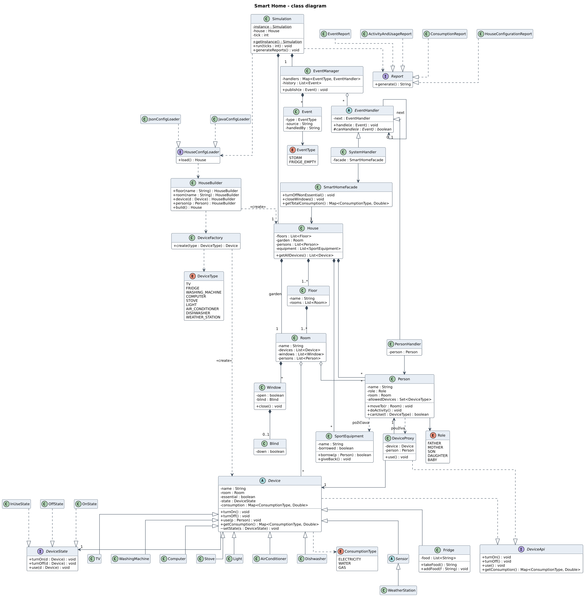

# Class diagram

{.diagram}

::: {.ai-note}
**Použití AI:** Při přípravě tohoto dokumentu byl použit model Anthropic Claude Opus 5.5. AI pomohlo
s vytvořením a vykreslením class diagramu ve formátu PlantUML (`.puml`) podle našeho popisu funkcionalit,
se zkontrolováním a doplněním nesrovnalostí v popisu funkcionalit a s formulací výpisu návrhových vzorů.
Výsledek jsme prošli, upravili (zjednodušení diagramu, výběr vzorů) a rozumíme mu.
:::

# Popis funkcionalít

```{=html}
<pre class="popis">
1.) Dom obsahuje 8 druhov spotrebičov - televízia, chladnička, práčka,
počítač, sporák, svetlo, klimatizácia a umývačka riadu. Okrem spotrebičov
dom obsahuje aj senzory (napr. meteostanica). Každé zariadenie patrí práve
jednej miestnosti a medzi miestnosťami sa nehýbe.

2.) Ovládanie cez API - člen domácnosti používa spotrebiče, cez systém
vieme zapínať a vypínať spotrebiče (ale nevieme zariadenia používať).
Zariadenia sú označené ako nutné alebo nedôležité - pri búrke ostávajú
zapnuté len nutné (chladnička, senzory).

3.) Zariadenia majú stavy vypnuté, zapnuté a používané - používať
sa môže len zapnutý spotrebič, podľa stavu majú zariadenia inú spotrebu.
Niektoré zariadenia majú obsah - napr. chladnička obsahuje jedlo.

4.) Každý člen má definované, s ktorými spotrebičmi vie interagovať
(napr. bábätko nesmie zapnúť sporák).

5.) Členovia domácnosti trávia cca 50 % času používaním spotrebičov,
zvyšok času trávia športom. Ak nie je voľné zariadenie alebo športové
náradie, osoba čaká.

6.) Každé zariadenie má danú spotrebu (elektrina, voda, plyn), závislú od
typu spotrebiča a stavu. Spotrebu je možné zistiť cez API.

7.) Každé zariadenie aj každá osoba je práve v jednej miestnosti, osoby sa
môžu medzi miestnosťami presúvať. Ak niekto zariadenie používa, musí byť
v tej istej miestnosti. Zariadenia a osoby náhodne generujú udalosti.

8.) Každý druh udalosti je obsluhovaný danou osobou, prípadne systémom
(napr. búrka -&gt; systém vypne nedôležité zariadenia, prázdna chladnička -&gt;
mama ide nakúpiť).

9.) Na konci behu sa vygenerujú 4 reporty -
    HouseConfigurationReport - obsahuje všetky konfiguračné dáta domu
        v hierarchii (napr. dom -&gt; poschodie -&gt; miestnosť -&gt; okno -&gt;
        žalúzie), vrátane členov domácnosti
    EventReport - obsahuje zoznam udalostí, zoskupené podľa typu,
        zdroja a cieľovej entity (kto udalosť obslúžil)
    ActivityAndUsageReport - obsahuje informácie o tom, koľkokrát
        ktorá osoba použila ktoré zariadenie
    ConsumptionReport - informuje o spotrebe (vody, plynu, elektriny a pod.)
        jednotlivých zariadení

10.) Konfigurácia domu sa načíta z JSON alebo priamo z Java triedy, obsahuje:
  - 5 členov domácnosti
  - 20 zariadení (8 druhov spotrebičov + senzory)
  - 5 kusov športového náradia
  - 6 miestností + záhrada


Používateľské scenáre:

1. Pustenie televízie
   Syn nájde voľnú televíziu, prejde do obývačky, televíziu zapne a sleduje.
   Spotreba sa počíta a použitie sa zaznamená. Keď je televízia obsadená, syn
   čaká.

2. Varenie
   Mama zoberie jedlo z chladničky a chce variť. Sporák je vypnutý, takže ho
   musí najprv zapnúť. Ak je chladnička prázdna, vznikne udalosť a mama ide
   nakúpiť.

3. Šport
   Dcéra si požičia bicykel a jazdí na záhrade. Ak je bicykel požičaný, čaká.

4. Búrka
   Meteostanica ohlási búrku. Systém zatvorí okná a vypne nedôležité zariadenia.
   Chladnička a senzory bežia ďalej.

5. Koniec simulácie
   Systém vygeneruje všetky štyri reporty do textových súborov.
</pre>
```

# Výpis problémů při návrhu a vytipované návrhové vzory

| Problém | Vzor | Řešení |
|---|---|---|
| Vypnuté zařízení nejde použít a každý stav má jinou spotřebu. | State | Každý stav (vypnuto, zapnuto, používá se) je vlastní třída a sám ví, co zařízení v daném stavu smí. |
| Každý člen smí používat jen některá zařízení. | Proxy | Osoba pracuje se zařízením přes `DeviceProxy`, který nejdřív zkontroluje, jestli na to má právo. |
| Systém potřebuje jednoduše ovládat celý dům. | Facade | `SmartHomeFacade` nabízí pár jednoduchých metod, např. vypni nedůležitá zařízení nebo zavři okna. |
| Kdo událost vyvolá, nemusí vědět, kdo ji vyřeší. | Observer | Událost se pošle do `EventManager` a ten ji předá tomu, kdo ji má obsloužit. |
| Událost má vyřešit ten, kdo zrovna může. | Chain of Responsibility | Obsluhovatelé jsou za sebou v řadě. Když první nemůže (např. máma není doma), pošle událost dalšímu. |
